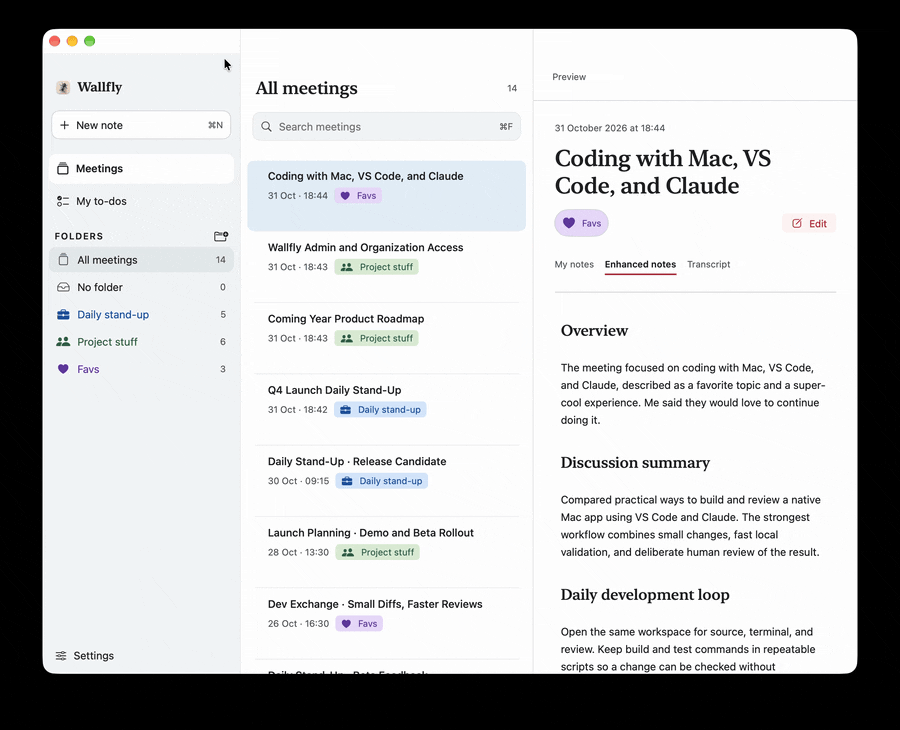

<div align="center">

# Wallfly 🪰

**Your meetings. Your AI. Your choice.**

Record, transcribe and summarize meetings with local models or your preferred cloud provider. Wallfly is completely free and open source. No subscription, no meeting bot, no Wallfly account.

[](LICENSE)
[](https://github.com/Constipn/wallflyAI/releases/latest)
[](#download)

[**Download for Mac**](https://github.com/Constipn/wallflyAI/releases/latest/download/Wallfly.dmg) · Windows coming later · [Report a bug](https://github.com/Constipn/wallflyAI/issues)



</div>

---

## Run everything locally. Or choose your cloud.

You choose the model, where it runs and what you spend. Transcription and note enhancement can use different providers.

| | Fully local | Your cloud provider |
|---|---|---|
| Transcription | Whisper Large V3 Turbo via [OpenWhispr](https://github.com/OpenWhispr/openwhispr), installed separately | Deepgram Nova-3 or OpenAI |
| Summaries and Enhanced Notes | Your local model through an OpenAI-compatible API | OpenAI, Anthropic (Claude), or another OpenAI-compatible API |
| Processing | On your computer; works offline after setup and model downloads | Required audio or text goes to your chosen provider |
| Cost | No API fees | Usage billed directly by your provider |

**All Wallfly features are free**, including AI features and MCP. No subscription or paywall. Optional cloud providers charge for usage; local models have no API fees.

Your meeting library is stored on your computer in either mode. Wallfly has no cloud storage or telemetry.

## Everything you need. All included.

### Core notetaker

- **Capture the conversation.** Record your microphone and meeting audio separately, labeled **Me** and **Others**. Works with Microsoft Teams, Google Meet, Zoom and other call apps. No bot joins your call.
- **Write your own notes.** Capture thoughts, questions and key points while you listen.
- **Follow the transcript.** Deepgram streams live text during the call; OpenAI and local Whisper also update the transcript as you record. Choose English, German or automatic language detection.
- **Keep meetings organized.** Browse your local library, group meetings into folders, search across them and export notes and transcripts as Markdown.
- **Get Teams-specific help.** Optional automatic call detection offers a recording reminder for native Teams calls. Teams detection and speaker names require Accessibility permission; optional local speaker matching helps attribute the conversation. Start recordings manually for other apps.

### AI features

- **Turn rough notes into Enhanced Notes.** Combine your own notes and the transcript into structured meeting notes and a concise summary, using the model you choose.
- **Capture outcomes.** Pull out decisions and to-dos, review suggested personal tasks and track accepted tasks in **My to-dos**. Unnamed meetings can receive a suggested title.
- **Connect your AI workflows.** Built-in [MCP support](#local-mcp-access) lets compatible tools search saved meetings and read notes and transcripts.

Note enhancement and to-do recognition start only when you request them. Your original notes and transcript remain available. You can also disable AI note enhancement entirely.

## How it works

1. **Choose your AI.** In setup, select transcription and note-enhancement providers. Use local models, bring your own cloud API keys, or combine them.
2. **Record and take notes.** Start a new note. Wallfly captures the conversation while you write, with a transcript available during the call.
3. **Create clear outcomes.** After stopping the recording, click **Enhance notes** to combine your notes and transcript into Enhanced Notes and review suggested to-dos.
4. **Keep and reuse.** Find the meeting in your local library, organize it in a folder, export it, or read it through an MCP-compatible AI tool.

Cloud providers require API keys. A ChatGPT or Claude subscription does not include API usage. Keys are stored in the macOS Keychain.

## Download

[**Download Wallfly.dmg**](https://github.com/Constipn/wallflyAI/releases/latest/download/Wallfly.dmg) from the [Releases page](https://github.com/Constipn/wallflyAI/releases/latest). Requires macOS 26 or later on Apple Silicon.

**Windows is planned for later.** The current release requires a Mac with Apple Silicon (M1 or newer).

1. Open the DMG and drag Wallfly to Applications.
2. The app is not notarized. Either run

   ```sh
   sudo xattr -dr com.apple.quarantine /Applications/Wallfly.app
   ```

   or try to open it once and then use System Settings → Privacy & Security → "Open Anyway" ("Dennoch öffnen" on German systems).
3. On first launch, a short setup asks for your storage location, AI providers and API keys, and the microphone and screen and system audio permissions.

<details>
<summary>Build from source</summary>

Requires the Swift 6.2 toolchain (Xcode 26).

```sh
git clone https://github.com/Constipn/wallflyAI.git
cd wallflyAI
./scripts/build.sh
open dist/Wallfly.app
```

The script creates a self-signed identity in `.local-signing/`. Keep that folder so macOS permissions survive rebuilds. The first build needs network access to download the Swift packages and the signing tool.

</details>

## Privacy

- **Stored on your Mac:** meetings as JSON files in `~/Library/Application Support/Wallfly`, or a folder you pick in Settings. A cloud-synced folder will sync your meetings. By default, audio is deleted after processing; transcript, notes and speaker names are kept. You can choose to keep the audio.
- **Sent over the network**, only to the providers you choose:
  - Audio for transcription goes to Deepgram or OpenAI. With local Whisper, audio stays on your Mac.
  - Your notes and the transcript go to the AI provider when you expand them. Turn this off, or use a local OpenAI-compatible server.
  - The speaker-recognition models are downloaded once from Hugging Face.
- **Fully local:** local Whisper plus a local OpenAI-compatible server (or no AI notes) keeps meeting processing on your Mac. Install OpenWhispr separately and download the required models before working offline.
- **Telemetry:** none. There is no Wallfly server and no account.

> **Recording consent:** No bot joins or announces the recording. Tell participants and obtain their consent before recording.

## Local MCP access

Wallfly includes `Contents/MacOS/wallfly-mcp` inside the app. In **Settings → MCP**, copy the configuration into a client supporting local stdio MCP servers. For the usual installation:

```json
{
  "mcpServers": {
    "wallfly": {
      "command": "/Applications/Wallfly.app/Contents/MacOS/wallfly-mcp",
      "args": []
    }
  }
}
```

Client configuration formats vary; use this command and argument list in your client's corresponding settings. Restart the connection after configuration. If you move the app, copy the configuration again. The helper follows the library selected in Wallfly, even after a storage move. For a manually selected library, use `"args": ["--library", "/absolute/path/to/library"]`.

The tools are `search_meetings` (text, participant and ISO 8601 date-time filters; empty query lists meetings), `get_meeting` (notes, tasks and metadata), and `get_transcript` (speakers, relative seconds, provisional state and known gaps). Search returns up to 20 meetings by default, maximum 100. Transcript pages default to 100 sections, maximum 500. To continue, pass `next_cursor` as `cursor` with all other arguments unchanged. If saved data changes, restart without a cursor.

All saved meetings in the library are readable by a configured client. No audio or credentials are returned, and no files are modified or uploaded by this helper. Your AI client may send the retrieved text to its provider. The helper makes no additional AI requests. Wallfly's window can remain closed; the Mac and library must be available. This is a local integration, with no cloud endpoint or background login service.

If the library is unavailable, connect its drive or open Wallfly to select its location. Corrupt records are reported as skipped during search; restore them from a backup or inspect them in Wallfly. The settings availability indicator is not a connection indicator. No Python, Node, or separate helper installation is needed.

## Contributing

Contributions are welcome! Open an [issue](https://github.com/Constipn/wallflyAI/issues) for bugs and ideas, or look at the issues labeled [`good first issue`](https://github.com/Constipn/wallflyAI/labels/good%20first%20issue).

If Wallfly saves you time, a ⭐ on GitHub helps others find it.

## License

[MIT](LICENSE) © 2026 Constipn

The vendored WebRTC audio-processing code keeps its BSD license and patent grant (`Sources/WebRTCAEC/LICENSE`, `Sources/WebRTCAEC/vendor-ns/LICENSE`, `Sources/WebRTCAEC/vendor-ns/PATENTS`, `Sources/WebRTCAEC/JSONCPP-LICENSE`). FluidAudio is under its own license.
