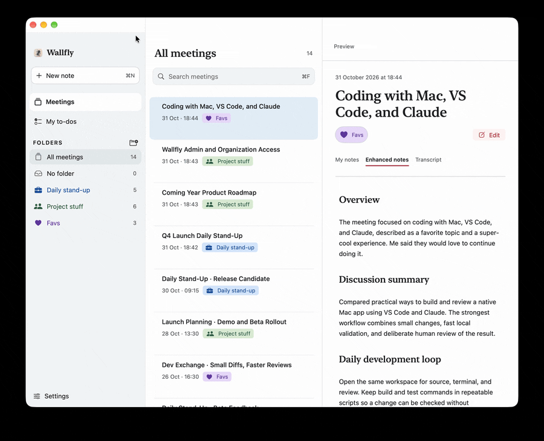

<div align="center">

# Wallfly for Mac 🪰

**Your meetings. Your AI. Your choice.**

This folder contains the macOS app of Wallfly. For the product overview, features and how it works, see the [main README](../README.md).

[](LICENSE)
[](https://github.com/Constipn/wallflyAI/releases/latest)
[](#requirements)

[**Download for Mac**](https://github.com/Constipn/wallflyAI/releases/latest/download/Wallfly.dmg) · [Report a bug](https://github.com/Constipn/wallflyAI/issues)



</div>

---

## Requirements

macOS 26 or later on a Mac with Apple Silicon (M1 or newer).

## Download and install

[**Download Wallfly.dmg**](https://github.com/Constipn/wallflyAI/releases/latest/download/Wallfly.dmg) from the [Releases page](https://github.com/Constipn/wallflyAI/releases/latest).

1. Open the DMG and drag Wallfly to Applications.
2. The app is not notarized. Either run

   ```sh
   sudo xattr -dr com.apple.quarantine /Applications/Wallfly.app
   ```

   or try to open it once and then use System Settings → Privacy & Security → "Open Anyway" ("Dennoch öffnen" on German systems).
3. On first launch, a short setup asks for your storage location, AI providers and API keys, and the microphone and screen and system audio permissions.

## Permissions

- **Microphone** and **screen and system audio:** requested during the first-launch setup. Wallfly records your microphone and the meeting audio separately, labeled **Me** and **Others**.
- **Accessibility** (optional): Teams detection and speaker names require Accessibility permission.

Cloud providers require API keys. Keys are stored in the macOS Keychain.

## Build from source

Requires the Swift 6.2 toolchain (Xcode 26).

```sh
git clone https://github.com/Constipn/wallflyAI.git
cd wallflyAI/macos
./scripts/build.sh
open dist/Wallfly.app
```

The script creates a self-signed identity in `.local-signing/`. Keep that folder so macOS permissions survive rebuilds. The first build needs network access to download the Swift packages and the signing tool.

## Privacy on the Mac

- **Stored on your Mac:** meetings as JSON files in `~/Library/Application Support/Wallfly`, or a folder you pick in Settings. A cloud-synced folder will sync your meetings. By default, audio is deleted after processing; transcript, notes and speaker names are kept. You can choose to keep the audio.
- **Sent over the network**, only to the providers you choose:
  - Audio for transcription goes to Deepgram or OpenAI. With local Whisper, audio stays on your Mac.
  - Your notes and the transcript go to the AI provider when you expand them. Turn this off, or use a local OpenAI-compatible server.
  - The speaker-recognition models are downloaded once from Hugging Face.
- **Fully local:** local Whisper plus a local OpenAI-compatible server (or no AI notes) keeps meeting processing on your Mac. Install [OpenWhispr](https://github.com/OpenWhispr/openwhispr) separately and download the required models before working offline.
- **Telemetry:** none. There is no Wallfly server and no account.

> **Recording consent:** No bot joins or announces the recording. Tell participants and obtain their consent before recording.

## Local MCP access

Wallfly includes `Contents/MacOS/wallfly-mcp` inside the app. In **Settings → MCP**, copy the configuration into a client supporting local stdio MCP servers. For the usual installation:

```json
{
  "mcpServers": {
    "wallfly": {
      "command": "/Applications/Wallfly.app/Contents/MacOS/wallfly-mcp",
      "args": []
    }
  }
}
```

Client configuration formats vary; use this command and argument list in your client's corresponding settings. Restart the connection after configuration. If you move the app, copy the configuration again. The helper follows the library selected in Wallfly, even after a storage move. For a manually selected library, use `"args": ["--library", "/absolute/path/to/library"]`.

The tools are `search_meetings` (text, participant and ISO 8601 date-time filters; empty query lists meetings), `get_meeting` (notes, tasks and metadata), and `get_transcript` (speakers, relative seconds, provisional state and known gaps). Search returns up to 20 meetings by default, maximum 100. Transcript pages default to 100 sections, maximum 500. To continue, pass `next_cursor` as `cursor` with all other arguments unchanged. If saved data changes, restart without a cursor.

All saved meetings in the library are readable by a configured client. No audio or credentials are returned, and no files are modified or uploaded by this helper. Your AI client may send the retrieved text to its provider. The helper makes no additional AI requests. Wallfly's window can remain closed; the Mac and library must be available. This is a local integration, with no cloud endpoint or background login service.

If the library is unavailable, connect its drive or open Wallfly to select its location. Corrupt records are reported as skipped during search; restore them from a backup or inspect them in Wallfly. The settings availability indicator is not a connection indicator. No Python, Node, or separate helper installation is needed.

## License

[MIT](LICENSE) © 2026 Constipn

The vendored WebRTC audio-processing code keeps its BSD license and patent grant (`Sources/WebRTCAEC/LICENSE`, `Sources/WebRTCAEC/vendor-ns/LICENSE`, `Sources/WebRTCAEC/vendor-ns/PATENTS`, `Sources/WebRTCAEC/JSONCPP-LICENSE`). FluidAudio is under its own license.
